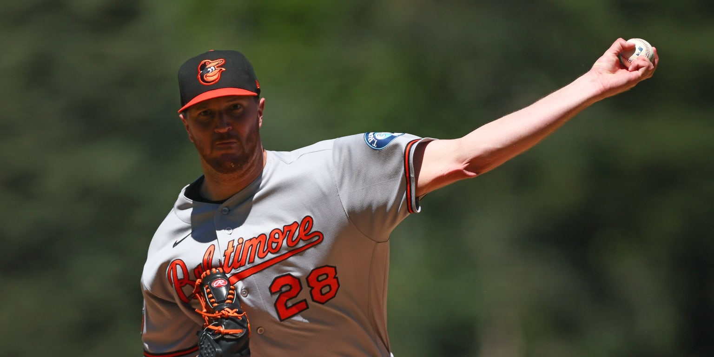
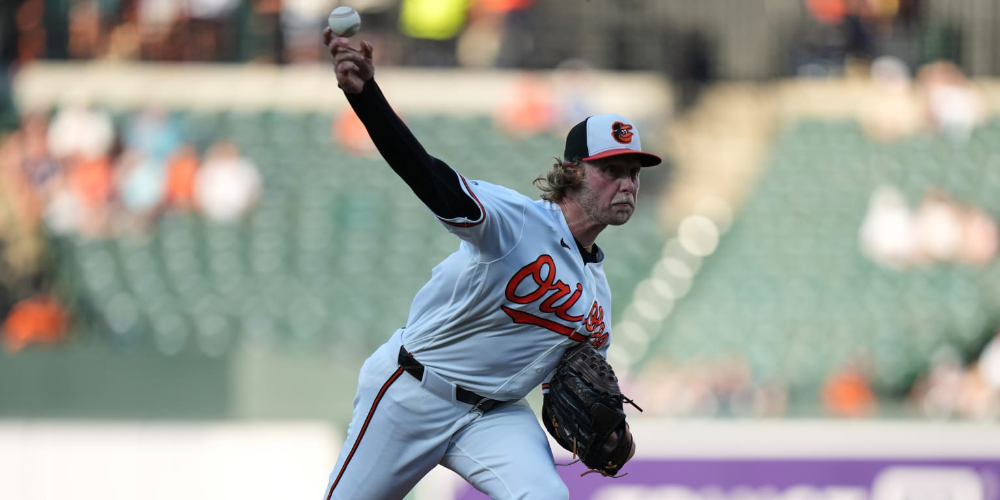
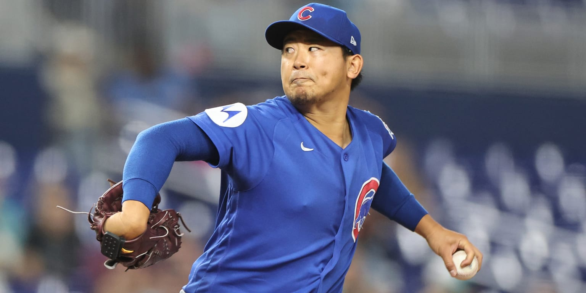

<em>November 24, 2026</em>

The Orioles have finally opened the checkbook for a frontline free agent starting pitcher. Unfortunately, they did so less than 24 hours after losing one.

The O’s have reportedly agreed to a five-year, $125 million contract with Freddy Peralta, following the departure of Trevor Rogers to the Chicago Cubs on a five-year, $120 million deal.

In isolation, the Peralta signing is an encouraging development. The Orioles have spent the better part of two years trying and failing to land an established frontline starter in free agency, and Peralta has a track record that rivals just about anyone they have pursued over that period.

But the Orioles entered this offseason needing to improve their starting rotation, not merely maintain it. So before we get too excited about the organization finally committing nine figures to a free agent pitcher, it&#x27;s worth examining whether they actually have a better rotation today than they did when the season ended.

<h2 data-source-paragraph="6"><strong>Peralta vs. Rogers</strong></h2>

Let&#x27;s start with how the two pitchers performed in 2026.

<table data-source-table="0"><thead><tr><th scope="col">Statistic</th><th scope="col">Freddy Peralta</th><th scope="col">Trevor Rogers</th></tr></thead><tbody><tr><th scope="row">Opening Day 2027 Age</th><td>30</td><td>29</td></tr><tr><th scope="row">Throws</th><td>Right</td><td>Left</td></tr><tr><th scope="row">Starts</th><td>32</td><td>30</td></tr><tr><th scope="row">Innings</th><td>169</td><td>169⅔</td></tr><tr><th scope="row">Record</th><td>10-11</td><td>10-11</td></tr><tr><th scope="row">ERA</th><td>4.42</td><td>4.03</td></tr><tr><th scope="row">ERA+</th><td>93</td><td>101</td></tr><tr><th scope="row">WHIP</th><td>1.325</td><td>1.185</td></tr><tr><th scope="row">FIP</th><td>4.28</td><td>3.45</td></tr><tr><th scope="row">Expected ERA</th><td>3.84</td><td>3.60</td></tr><tr><th scope="row">Strikeouts</th><td>156</td><td>157</td></tr><tr><th scope="row">Strikeout Rate</th><td>21.4%</td><td>22.5%</td></tr><tr><th scope="row">Walk Rate</th><td>8.6%</td><td>5.6%</td></tr><tr><th scope="row">K-BB%</th><td>12.8%</td><td>16.9%</td></tr><tr><th scope="row">Home Runs Allowed</th><td>23</td><td>19</td></tr><tr><th scope="row">Barrel Rate</th><td>5.8%</td><td>6.8%</td></tr><tr><th scope="row">Hard-Hit Rate</th><td>37.2%</td><td>36.2%</td></tr><tr><th scope="row">Reported Contract</th><td>5 years, $125M</td><td>5 years, $120M</td></tr></tbody></table>

Based strictly on their 2026 performance, Rogers was the better pitcher, and it wasn&#x27;t particularly close.

Rogers pitched virtually the same number of innings, struck out one more hitter, walked 24 fewer and surrendered four fewer homers. His FIP was more than eight-tenths of a run better than Peralta&#x27;s, suggesting the difference between the two was actually greater than their ERAs would indicate.

Of course, looking exclusively at last season does Peralta a considerable disservice.




From 2023 through 2025, Peralta made 95 starts, threw 516 innings and struck out more than 600 hitters while pitching to approximately a 3.40 ERA. He registered three consecutive 200-strikeout seasons and has now made at least 30 starts in four consecutive seasons.

Rogers has made 30 starts in a season exactly once.

So Peralta does have a much better track record of durability, and If you&#x27;re committing $120 million or more to a pitcher over the next five seasons, that carries considerable weight. There is a much larger body of evidence supporting Peralta&#x27;s ability to anchor a major league rotation.

The question is whether the Orioles are getting anything close to that version of Peralta.

<h2 data-source-paragraph="15"><strong>What Happened to Freddy Peralta in 2026?</strong></h2>

Peralta&#x27;s season was a strange one. After finishing 2025 with a career-best 2.70 ERA for Milwaukee, he was traded to the Mets, where he proceeded to pitch to a 4.99 ERA across 22 starts before being dealt again at the trade deadline.

His first four starts with Tampa Bay were even worse, producing a 7.17 ERA. Then something clicked.

Peralta posted a 0.79 ERA over his final six regular season starts, followed that up with an excellent postseason run through the ALCS and was named ALCS MVP. He finished his ten regular season starts with Tampa with a 3.25 ERA.



There are some tangible reasons to believe the late-season turnaround was more than just a hot streak. The concern is that one of the defining characteristics of Peralta&#x27;s success throughout his career largely disappeared in 2026.



Peralta&#x27;s strikeout rate fell nearly seven percentage points last season. His walk rate improved slightly, but not nearly enough to offset the reduction in strikeouts.

That&#x27;s a more concerning development than the 4.42 ERA itself. There are any number of reasons a pitcher can post an inflated ERA over the course of a season, but losing that much of your swing-and-miss ability makes it considerably more difficult to maintain frontline production.

Interestingly, the quality of contact Peralta allowed actually improved.

<table data-source-table="3"><thead><tr><th scope="col">Statistic</th><th scope="col">2024</th><th scope="col">2025</th><th scope="col">2026</th></tr></thead><tbody><tr><th scope="row">Average Exit Velocity</th><td>87.6 mph</td><td>88.0 mph</td><td>87.6 mph</td></tr><tr><th scope="row">Barrel Rate</th><td>8.7%</td><td>9.3%</td><td>5.8%</td></tr><tr><th scope="row">Expected wOBA</th><td>.307</td><td>.289</td><td>.302</td></tr><tr><th scope="row">Expected ERA</th><td>3.83</td><td>3.43</td><td>3.84</td></tr><tr><th scope="row">Actual ERA</th><td>3.68</td><td>2.70</td><td>4.42</td></tr></tbody></table>

Despite the decline in strikeouts, Peralta&#x27;s expected ERA was almost identical to his 2024 mark. Hitters were putting more balls in play against him, but they were having a harder time squaring them up.

In fact, the Statcast numbers suggest that the gap between Peralta&#x27;s actual ability in 2025 and 2026 wasn&#x27;t nearly as dramatic as the difference between a 2.70 and 4.42 ERA would lead you to believe.

<h3 data-source-paragraph="25"><strong>What Did the Rays Fix?</strong></h3>

As they seemingly always do, the Rays managed to find something in a struggling pitcher that his previous organization couldn&#x27;t.

A <a href="https://fantasy.fangraphs.com/freddy-peralta-a-lost-season-that-was-saved/">September analysis from FanGraphs</a> identified Peralta&#x27;s changeup as one of the biggest drivers of his turnaround.

The changeup had been his least valuable pitch with the Mets, but rather than abandon it, the Rays helped him improve its location and encouraged him to throw it more frequently, including against right-handed hitters.

<table data-source-table="4"><thead><tr><th scope="col">Pitch</th><th scope="col">With Mets</th><th scope="col">First 9 Starts with Rays</th></tr></thead><tbody><tr><th scope="row">Four-Seam Fastball</th><td>53.4%</td><td>51.9%</td></tr><tr><th scope="row">Changeup</th><td>20.8%</td><td>30.3%</td></tr><tr><th scope="row">Curveball</th><td>13.3%</td><td>11.4%</td></tr><tr><th scope="row">Slider/Sweeper</th><td>11.2%</td><td>6.3%</td></tr></tbody></table>

Peralta also made some adjustments to his delivery, with <a href="https://www.mlb.com/rays/news/freddy-peralta-finding-success-with-rays-after-adjustments">MLB.com reporting</a> that he had regained some of the release extension he lost during his time in New York. That can help the fastball play a little better because hitters have fractionally less time to react.

The improved changeup gives hitters another pitch to account for when they are gearing up for the elevated fastball that has been the foundation of Peralta&#x27;s success throughout his career.

The concern is that even after the trade to Tampa Bay, Peralta didn&#x27;t fully rediscover his previously elite strikeout ability. His 43 strikeouts and 15 walks over 55⅓ innings with the Rays were hardly the numbers of a dominant power pitcher.

There is enough evidence here to be optimistic that Peralta could be better than his 2026 season ERA. I&#x27;m not quite ready to buy that the Orioles have acquired the 2025 version of Peralta, though.

A realistic expectation is probably an ERA somewhere in the 3.50 to 4.00 range with the potential to be considerably better if he can recapture his swing-and-miss stuff. That would make him a valuable addition to the Orioles rotation, even if it doesn&#x27;t necessarily make him an ace.

<h2 data-source-paragraph="34"><strong>Did the Orioles Let the Better Pitcher Get Away?</strong></h2>

<figure class="peralta-photo"><figcaption>Trevor Rogers pitching for the Orioles. <a href="https://www.mlb.com/news/trevor-rogers-keys-to-success-in-2027">Photo: MLB.com</a></figcaption></figure>

We spent a good portion of last year trying to determine how much of Trevor Rogers&#x27; remarkable 2025 season was sustainable. The conclusion was that the 1.81 ERA was almost certainly unsustainable, but there were enough meaningful changes to Rogers&#x27; arsenal, velocity and command to believe the Orioles had unlocked a legitimately good major league starter.

His 2026 season may have provided even more evidence to support that conclusion, despite his ERA more than doubling.

<table data-source-table="5"><thead><tr><th scope="col">Statistic</th><th scope="col">2024</th><th scope="col">2025</th><th scope="col">2026</th></tr></thead><tbody><tr><th scope="row">ERA</th><td>4.92</td><td>1.81</td><td>4.03</td></tr><tr><th scope="row">Expected ERA</th><td>5.10</td><td>3.41</td><td>3.60</td></tr><tr><th scope="row">Strikeout Rate</th><td>17.3%</td><td>24.3%</td><td>22.5%</td></tr><tr><th scope="row">Walk Rate</th><td>10.0%</td><td>6.9%</td><td>5.6%</td></tr><tr><th scope="row">Barrel Rate</th><td>8.4%</td><td>7.6%</td><td>6.8%</td></tr><tr><th scope="row">Hard-Hit Rate</th><td>44.4%</td><td>48.4%</td><td>36.2%</td></tr></tbody></table>

Rogers actually improved his walk rate, barrel rate and hard-hit rate last season. His expected ERA was only slightly worse than in 2025, and the improvements in his ability to command the strike zone suggest his transformation into a quality starter was very real.

His full season numbers are also dragged down considerably by a disastrous first two months.

A <a href="https://www.mlb.com/news/trevor-rogers-keys-to-success-in-2027">recent MLB.com analysis of Rogers</a> broke his performance over the last two seasons into three stretches.



Over his final 20 starts as an Oriole, Rogers was every bit as good as his underlying numbers suggested. And perhaps the most encouraging thing about his performance is that he accomplished it despite the complete deterioration of what was once one of his best pitches.

Rogers&#x27; changeup went from one of his most valuable offerings in 2025 to one of the least effective changeups in baseball in 2026. He compensated by relying more heavily on his deceptive fastball and the sweeper he developed prior to the 2025 season.

If Rogers can rediscover the effectiveness of that changeup, there is reason to believe he could be even better going forward.

The counterargument, of course, is that Rogers has had several injury-plagued seasons and has only really established himself as a consistent starter over the last two years. Peralta has spent much of his career being the kind of pitcher the Cubs are hoping Rogers has become.

In a vacuum, at virtually identical contract values, I would have slightly preferred Rogers. He&#x27;s a year younger, has better recent underlying numbers and would give the Orioles a left-handed presence among their established starters.

That doesn&#x27;t make signing Peralta instead a bad decision. His history of durability and effectiveness makes the alternative perfectly defensible. The O&#x27;s also stand to receive draft compensation for the departure of Rogers, while Peralta was ineligible to receive a qualifying offer because of his midseason trade.

We also don&#x27;t know what the Orioles offered Rogers, whether he simply preferred Chicago or how the financial structure of the two contracts compares.

Ultimately, though, I see the exchange as essentially a lateral move with regard to the quality of the 2027 rotation.

<h2 data-source-paragraph="48"><strong>How Much Better Is the Orioles Rotation?</strong></h2>

<figure class="peralta-photo"><figcaption>Shane Baz pitching against the Yankees in August 2026. <a href="https://www.mlb.com/news/shane-baz-strikes-out-10-in-orioles-loss-to-yankees">Photo: MLB.com</a></figcaption></figure>

The Orioles finished the 2026 season with a 4.24 starting rotation ERA, good for 17th in MLB. They were a slightly below-average team in terms of starting pitching, and the underlying numbers didn&#x27;t paint a much better picture.

As we discussed back in August when examining how the failure to land a frontline starter may have cost the Orioles their season, a significant portion of the problem was the performance at the back end of the rotation.

That remained true over the course of the full season.

<table data-source-table="7"><thead><tr><th scope="col">Pitcher</th><th scope="col">Starts</th><th scope="col">Innings</th><th scope="col">ERA</th><th scope="col">FIP</th></tr></thead><tbody><tr><th scope="row">Shane Baz</th><td>31</td><td>179⅔</td><td>4.11</td><td>3.62</td></tr><tr><th scope="row">Trevor Rogers</th><td>30</td><td>169⅔</td><td>4.03</td><td>3.45</td></tr><tr><th scope="row">Kyle Bradish</th><td>29</td><td>155</td><td>4.12</td><td>4.36</td></tr><tr><th scope="row">Brandon Young</th><td>28</td><td>156⅔</td><td>3.56</td><td>4.47</td></tr><tr><th scope="row">Chris Bassitt</th><td>18</td><td>102</td><td>4.41</td><td>4.31</td></tr><tr><th scope="row">Trey Gibson</th><td>8</td><td>39⅔</td><td>6.13</td><td>5.65</td></tr><tr><th scope="row">Cade Povich</th><td>7</td><td>37</td><td>4.38</td><td>4.99</td></tr><tr><th scope="row">Dean Kremer</th><td>7</td><td>36</td><td>6.50</td><td></td></tr></tbody></table>

<em>Individual statistics include all appearances for Baltimore, including occasional relief appearances.</em>

The Orioles&#x27; top four starters combined to make 118 of the team&#x27;s 161 starts last season. Using the earned runs and innings pitched from those four starters and the team&#x27;s aggregate starting pitching numbers, we can calculate the performance they received in the other 43 starts.



There were two primary issues with the Orioles rotation last season. They didn&#x27;t have anyone who consistently pitched like an ace, and they received terrible production out of the fifth spot and their depth starters.

Signing Peralta to replace Rogers doesn&#x27;t necessarily solve either problem.

The projected 2027 rotation currently looks something like this:

Freddy Peralta (RHP)

Kyle Bradish (RHP)

Shane Baz (RHP)

Brandon Young (RHP)

Cade Povich/Trey Gibson/Other Internal Options

There is some upside here, but there are also some familiar concerns.

Bradish&#x27;s 21.2% strikeout rate and 10.5% walk rate last season bear little resemblance to the pitcher we saw prior to Tommy John surgery. The good news is that he made 29 starts, and another offseason removed from his elbow reconstruction could help him rediscover some of that previously dominant form.

However, the Orioles would be taking a considerable risk counting on him to do so.

Baz may actually be the returning starter to be most optimistic about. His 6-15 record and 4.11 ERA don&#x27;t do justice to how well he pitched for much of last season. His 3.62 FIP was almost half a run lower than his ERA, he took the ball 31 times and he limited opposing hitters to 15 homers in nearly 180 innings. If the Orioles can unlock more swing-and-miss ability from his arsenal, there is still considerable room for improvement.

On the other side of that equation is Young. His development into a legitimate major league starter was one of the biggest positives to come out of last season, but his 4.47 FIP and strikeout rate below 20% suggest we shouldn&#x27;t expect another 3.56 ERA. His ability to fill the fourth or fifth spot in the rotation going forward is a nice development for the organization. Expecting him to pitch like a No. 2 would be asking far too much.

So for all the upside of a Peralta, Bradish and Baz trio at the top of the rotation, there is still a scenario where all three produce ERAs hovering around 4.00 and Young regresses a bit.

Sound familiar?

The Orioles do have a more promising pitching pipeline than they did a year ago, particularly with the acquisitions of Anthony Eyanson and the reacquisition of Michael Forret at the trade deadline. Joseph Dzierwa and Luis De León also give the organization some interesting left-handed options.

But the O&#x27;s should be looking at those guys as potential reinforcements and depth throughout the season, not as an excuse to leave a rotation spot open for a prospect who may or may not be ready.

<h2 data-source-paragraph="71" id="what-would-another-quality-starter-mean"><strong>What Would Another Quality Starter Mean?</strong></h2>

Using last season&#x27;s actual rotation production, we can put some numbers behind the value of another starting pitching acquisition.

For this exercise, I held the overall starting pitching workload constant at 863⅓ innings. Peralta inherits Rogers&#x27; workload, the returning starters retain their workloads from last season, and any additional starter replaces 160 innings of the 5.16 ERA production the Orioles received from outside their top four.

The results:



<em>The reasonable-performance scenario assumes ERAs of 3.80 for Peralta, 4.00 for Bradish, 3.80 for Baz and 4.20 for Young. Remaining depth innings are held at last season&#x27;s 5.16 ERA. Runs prevented are converted to wins at approximately ten runs per win. This is an illustrative calculation rather than a formal projection.</em>

The interesting thing about this exercise is that the expected improvement from a Peralta bounce-back and a better season from Baz could be largely offset by regression from Young.

Simply replacing Rogers with Peralta and hoping for some internal improvement may get the O&#x27;s right back to where they were last season.

However, adding another quality starter could make a difference of two to three wins by itself. And that&#x27;s without assuming that the Orioles have acquired another ace or that any of their existing starters take a massive step forward.

Given that the Orioles finished last season with 79 wins, we shouldn&#x27;t be dismissive of the value of those additional wins.

Which brings us to the next question.

<h2 data-source-paragraph="81"><strong>Who Is Left on the Free Agent Market?</strong></h2>

With Tarik Skubal, Rogers, Peralta, Sonny Gray, Kaima Taira and Kris Bubic off the board, the market for established frontline pitchers has thinned considerably.

There are still some intriguing options, though very few that I would confidently project as a No. 2 starter on a legitimate World Series contender.

<h3 data-source-paragraph="84"><strong>Michael King (RHP, 32)</strong></h3>

King is probably the best established starter remaining on the market. He was one of the pitchers the Orioles pursued last offseason before he ultimately returned to San Diego, and he rewarded the Padres with a 3.21 ERA over a career-high 185 innings in 2026.

Over his three seasons with San Diego, King pitched to a 3.15 ERA across 432 innings.

The problem is that his underlying numbers have trended in the wrong direction. His 4.42 expected ERA last season was more than a full run higher than his actual ERA, and his strikeout rate has declined considerably since his breakout 2024 campaign.

King has consistently outperformed his expected ERA throughout his career, so we shouldn&#x27;t necessarily expect that entire discrepancy to disappear. However, Steamer projects him for a 4.07 ERA and 2.5 WAR in 2027.

FanGraphs&#x27; early contract estimate for King was four years and $100 million, and given what we&#x27;ve seen from the market thus far, that could prove conservative.

I&#x27;d certainly be happy to add King to the Orioles rotation. But committing another $100 million to a pitcher whose swing-and-miss ability is trending in the wrong direction, immediately after doing the same with Peralta, would carry some significant risk. But hey, it&#x27;s not my money, and the owner says he wants to win.

<h3 data-source-paragraph="91"><strong>Kevin Gausman (RHP, 36)</strong></h3>

A reunion with Gausman might not be the most exciting option for Orioles fans, but the former fourth overall pick could represent one of the better short-term investments on the market.

Gausman was one of the most consistently productive starters in baseball from 2021 through 2025, posting a 3.34 ERA across 158 starts. However, he struggled to a 4.51 ERA between Toronto and Chicago last season, and his ability to miss bats has diminished considerably from his peak.

His signature splitter remains an effective weapon, but his fastball isn&#x27;t nearly as effective as it once was. At 36, there&#x27;s a legitimate concern that we&#x27;re seeing the beginning of a more significant decline rather than simply a down season.

Interestingly, Steamer projects Gausman for a 4.08 ERA, 3.96 FIP and 2.8 WAR over 179 innings in 2027, making him more valuable than King, Imanaga or Griffin by that measure. His durability remains a significant part of his appeal.

FanGraphs&#x27; Ben Clemens projected a one-year, $17 million contract for Gausman, though the median crowdsourced estimate was considerably higher at two years and $44 million. There&#x27;s also some uncertainty as to whether Gausman intends to continue pitching in 2027.

I&#x27;m not particularly interested in committing multiple years to a 36-year-old pitcher with declining stuff, but if Gausman is willing to pitch on a one-year deal, the Orioles could do considerably worse. He would provide some much-needed stability to the rotation without compromising the organization&#x27;s long-term financial flexibility.

<h3 data-source-paragraph="99"><strong>Shota Imanaga (LHP, 33)</strong></h3>

<figure class="peralta-photo"><figcaption>Shota Imanaga pitching for the Cubs in September 2026. <a href="https://www.mlb.com/news/shota-imanaga-one-run-cubs-win-over-marlins">Photo: MLB.com</a></figcaption></figure>

Imanaga may be the best combination of roster fit, price and established performance remaining on the market.

After bursting onto the scene with a 2.91 ERA as a rookie in 2024, Imanaga has put together two more productive seasons in Chicago with ERAs of 3.73 and 3.77. He threw 174⅓ innings last season across 32 starts and struck out 174 hitters while maintaining a 1.10 WHIP.

Imanaga has excellent command, a deceptive elevated fastball and a very effective splitter. His fastball velocity also rebounded last season after dipping a bit in 2025.

The concern is his extreme fly-ball profile. Imanaga has allowed 66 home runs over the last two seasons, which was tied for the most in baseball over that period. It&#x27;s a particularly important consideration when evaluating whether he is someone you would trust against a powerful postseason lineup.

However, Steamer projects Imanaga for a 4.06 ERA and 2.4 WAR next season, essentially identical production to what is expected from King.

The difference is the contract. FanGraphs&#x27; Ben Clemens projected two years and $28 million for Imanaga, though the median crowdsourced estimate was a bit higher at $37.5 million over two years.

Even at the higher price, Imanaga could provide comparable expected production to King without the same long-term financial commitment. He would also give the Orioles a proven left-handed starter, something they currently lack.

<h3 data-source-paragraph="107"><strong>Foster Griffin (LHP, 31)</strong></h3>

Griffin is one of the more underrated options on the market.

After failing to establish himself in the majors earlier in his career, the former first-round pick spent three seasons pitching in Japan before returning to MLB last season.

Griffin made 31 starts between Washington and Cleveland, posting a 3.60 ERA and 3.96 FIP over 172⅔ innings.

He doesn&#x27;t have particularly impressive velocity, averaging just over 91 mph with his fastball, but he has a seven-pitch arsenal and a walk rate of just 6.2%.

Interestingly, Steamer projects Griffin to be slightly more valuable than both King and Imanaga in 2027, with a 3.90 ERA and 2.6 WAR.

There is some risk in committing significant money to a pitcher with just one productive MLB season under his belt, but Griffin is younger than either of those two and could be available at a considerably more palatable price than King.

<h3 data-source-paragraph="114"><strong>Nick Pivetta (RHP, 34)</strong></h3>

Pivetta is perhaps the most intriguing buy-low opportunity among the established MLB starters.

After an excellent 2025 season in San Diego, Pivetta posted a 2.86 ERA and 2.21 FIP last season. Unfortunately, he was limited to just 34⅔ innings due to a right elbow flexor strain.

He returned late in the season and pitched to a 1.45 ERA across his final five regular season starts.

There is legitimate frontline potential here if Pivetta can stay healthy, though his elbow injury and the Padres&#x27; decision to decline his option would warrant considerable scrutiny from the Orioles&#x27; medical staff.

I&#x27;d have no problem taking a chance on Pivetta with an incentive-heavy contract. I&#x27;d have a considerable problem with counting on him to make 30 starts and allowing that to dictate the rest of the offseason.



<h2 data-source-paragraph="120"><strong>The Peralta Signing Should Be the Beginning, Not the End</strong></h2>

Imagine how differently we&#x27;d be discussing the Peralta signing had the Orioles also managed to retain Rogers.

A rotation of Peralta, Rogers, Bradish, Baz and Young would have legitimate postseason upside. You&#x27;d have two starters with recent stretches of frontline performance, another in Bradish who has previously demonstrated ace-level ability and two young starters at the back end of the rotation with room for further development.

Add in the promising young arms approaching the majors and you would finally have the type of rotation Orioles fans have been hoping to see assembled around Gunnar Henderson and the rest of the lineup. Instead, the O&#x27;s remain one established starter short of that position, and the remaining free agent market isn&#x27;t particularly inspiring.

The Peralta signing deserves some praise. For years we&#x27;ve criticized Elias and ownership for failing to commit significant long-term money to an established free agent starting pitcher. They have now done exactly that, and I certainly hope it signals a change in how the organization approaches the position.

But spending $125 million on a starting pitcher is not the same as improving your starting rotation by $125 million. Especially when you allowed another starter worth $120 million on the open market to walk out the door the night before.

Had the Orioles done this last offseason, when they still had Rogers under contract, it would have represented a significant upgrade and potentially changed the trajectory of their 2026 season.

As things currently stand, they&#x27;ve made a substantial financial commitment to construct a rotation that is probably about as good as the one that finished 17th in baseball last season.

If Peralta is the first of two or even three significant starting pitching acquisitions this winter, there is reason for optimism that the O&#x27;s are finally addressing the issue that has plagued them since the departure of Corbin Burnes.



If he&#x27;s the only one, the Orioles will once again enter a season hoping that health, internal development and a few bounce-back performances will solve the rest of their pitching problems.

After the last two seasons, you&#x27;d think they would have learned that lesson by now.

<em>Statistics through the conclusion of the 2026 season. Free agent availability and reported contracts as of November 24, 2026. Statistical sources:</em> <a href="https://www.baseball-reference.com/teams/BAL/2026.shtml">Baseball Reference</a><em>,</em> <a href="https://baseballsavant.mlb.com/">Baseball Savant</a><em>,</em> <a href="https://www.fangraphs.com/">FanGraphs</a><em> and</em> <a href="https://www.mlb.com/orioles/stats/pitching">MLB.com</a><em>.</em>

